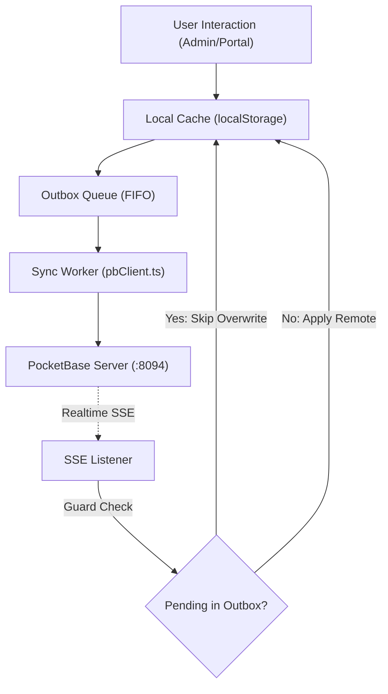

# Domain Model & Agent Reference — VPS Helpdesk CRM

Dokumen spesifikasi domain terpadu untuk AI Coding Agent dan kontributor repositori `ticketing-system`. Seluruh pemodelan domain merujuk pada kamus istilah resmi [`GLOSSARY.md`](file:///c:/Users/rizky/Documents/Dev/ticketing-system/GLOSSARY.md).

---

## 1. Domain Entities & Invariants

### 1.1 Requester (Pelapor)
- **Definisi:** Pengguna yang melaporkan masalah melalui salah satu dari 7 aplikasi ekosistem VPS.
- **Identitas Komposit (Composite Key):** `{app_slug}:{external_uid}`.
  - Contoh: `snackloop:admin_kiky`, `recruiter:employer@demo.com`.
  - **Invarian Keamanan:** Tidak ada entitas pelapor yang boleh diidentifikasi hanya dengan `externalUid` tanpa menyertakan `appId`. Setiap query atau verifikasi akses tiket wajib memeriksa:
    `t.appId === requester.appId && t.requesterUid === requester.externalUid`
- **JIT Provisioning:** Entitas pelapor dibuat secara instan saat pertama kali mengakses `/handoff`.

### 1.2 Ticket (Tiket Bantuan)
- **Definisi:** Catatan kendala atau pertanyaan yang diajukan oleh pelapor.
- **Kode Tiket (Display ID):** `{PREFIX}-{SEQ}` (misal `SNL-001`, `REC-042`).
- **Siklus Status:**
  - `open` (Baru) → `in_progress` (Diproses) → `waiting_on_user` (Menunggu Balasan) → `solved` (Selesai) → `closed` (Ditutup).
- **Aturan Reopen Otomatis:** Pesan balasan dari pelapor pada tiket berstatus `waiting_on_user` atau `solved` wajib mengubah status tiket kembali menjadi `in_progress`.
- **Aturan Penutupan Permanen:** Tiket berstatus `closed` tidak boleh menerima pesan balasan baru baik dari pelapor maupun admin.

### 1.3 Message & Internal Note (Pesan & Catatan Internal)
- **`isInternalNote: true`:**
  - Hanya dapat dibuat oleh Superadmin.
  - **Kerahasiaan Mutlak:** Catatan internal tidak boleh dirender atau diakses pada rute portal pelapor (`/portal/ticket/:id`).

### 1.4 Handoff Security (HMAC-SHA256)
- **Formula Signature:** `HMAC-SHA256("${app}:${uid}:${ts}", secret)`.
- **Masa Berlaku:** Dikonfigurasi di `settings.handoffExpiryMinutes` (default: 15 menit).
- **Allowed Origins:** Diverifikasi terhadap whitelist domain di `settings.allowedOrigins`.

---

## 2. Arsitektur Offline-First & Outbox Pattern

### Invarian Sinkronisasi:
1. **Optimistic Local Mutation:** Setiap aksi admin atau pelapor segera mengubah local store dan mencatat entry ke outbox.
2. **Realtime Invalidation Guard:** Event Server-Sent Events (SSE) dari PocketBase yang masuk saat record masih memiliki operasi pending di `outbox` **wajib diabaikan** untuk mencegah pembatalan mutasi lokal yang sedang menunggu konfirmasi server.

---

## 3. Ekosistem 7 Aplikasi VPS

| ID | Nama Aplikasi | Port / Path | Peran Utama |
| :--- | :--- | :--- | :--- |
| `snackloop` | SnackLoop POS | `/snackloop/` (:8080) | Kasir & Rekap UMKM |
| `recruiter` | Platform Rekrutmen | `/recruiter/` (:3000) | Lowongan & Lamaran Kerja |
| `wedding` | Undangan Digital | `/wedding/` (:8081) | Tamu & Buku Acara |
| `life-planner` | Life Planner | `/life-planner/` (:8082) | Habit & Keuangan Pribadi |
| `ai-endurance` | AI Endurance Coach | `:8445` | Analisis Atlet Lari |
| `kept` | Kept Vault | `/kept/` (:8083) | Dokumen Terenkripsi |
| `diskon-bot` | Diskon Bot Telegram | `/diskon-bot/` (:8084) | Notifikasi Promo |

---

## 4. Standar Terminologi UI (Indonesian vs English)

Semua agen wajib menggunakan istilah kamus domain:
- **Pelapor** (bukan *Klien* atau *Customer*)
- **ID Komposit** (bukan *Combined ID*)
- **Catatan Internal** (bukan *Private Note*)
- **Template Balasan Cepat** (bukan *Pre-made Answers*)
- **Peta Kesehatan Aplikasi** / **Dashboard Analitik**
