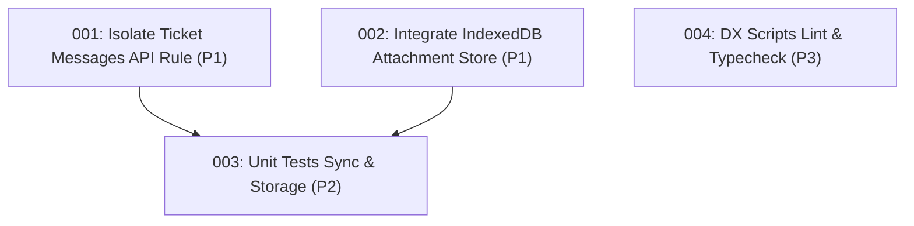

# Implementation Plans Index

Audited at commit `e0e49f8` using the `shadcn/improve` advisory framework.

## Status Summary

| Plan | Priority | Effort | Category | Status | Depends On | Summary |
| :--- | :--- | :--- | :--- | :--- | :--- | :--- |
| [001-isolate-ticket-messages-api-rule.md](./001-isolate-ticket-messages-api-rule.md) | P1 | S | Security | DONE | None | Enforce multi-tenant authorization rule on PocketBase `ticket_messages` collection |
| [002-integrate-indexeddb-attachment-store.md](./002-integrate-indexeddb-attachment-store.md) | P1 | M | Perf / Bug | DONE | None | Wire orphaned `attachmentStore.ts` to keep large base64 attachments out of localStorage quota |
| [003-unit-tests-sync-and-storage.md](./003-unit-tests-sync-and-storage.md) | P2 | M | Tests | DONE | None | Establish automated test suite for `storageService.ts` and `pbClient.ts` outbox engine |
| [004-dx-scripts-lint-typecheck.md](./004-dx-scripts-lint-typecheck.md) | P3 | S | DX | DONE | None | Add standalone `npm run typecheck` and `npm run lint` scripts in `package.json` |

---

## Recommended Execution Order & Dependencies

1. **Plan 001** (Security - Critical): Hardens tenant message boundaries before any sync changes.
2. **Plan 002** (Performance & Reliability): Prevents localStorage crashes on mobile devices with large screenshots.
3. **Plan 003** (Test Coverage): Establishes characterization test coverage over offline outbox and storage operations.
4. **Plan 004** (DX & Tooling): Provides instant typecheck and lint verification for subsequent refactors.

---

## Considered and Rejected Findings

- **Reported SSRF on proxy configuration:** Evaluated and rejected as by-design.
- **Micro-optimizations on table CSS transitions:** Rejected because current CSS hardware-accelerated tokens (`cubic-bezier(0.22, 1, 0.36, 1)`) already operate within frame budgets.
